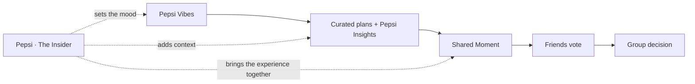

# Pepsi Moments

**Make Pepsi Part of the Moment.**

> From “What should we do?” to “Let's make it a moment.”

Pepsi Moments is a mobile-first group experience for discovering things to do in Miami, sharing a room with friends, and choosing a plan together. Instead of another endless group chat, everyone reacts to the same curated set of experiences and the group gets a result shaped by its preferences.

**Built for the Spotdly creative challenge.** Spotdly is the creative studio behind the brief; **Pepsi Moments** is the name of this product concept.

<!-- Add a current product screenshot or short demo GIF here. -->

## The idea

**Turn making plans into a social game.**

One friend starts a Moment, picks a Pepsi Vibe, curates a deck of Miami plans and shares a link. Friends join from their phones, swipe through the same options and vote. Likes, dislikes and a one-time Pepsi Boost turn individual reactions into a shared ranking.

The goal is not to make Pepsi an ad placed next to the experience. Pepsi becomes **The Insider**: a point of view that helps the group discover a mood, explore Miami and make a moment together.

## Try the experience

- **Live demo:** https://pepsi-plans.netlify.app/
- **Repository:** https://github.com/JassoEC/pepsi-plans

The prototype uses curated sample experiences and illustrative imagery. It does not claim live venue availability or reservations.

## Experience flow

Pepsi acts as **The Insider**: it sets the mood, curates relevant experiences and gives the group a shared starting point. Friends make the decision together — Pepsi guides discovery, but never chooses the winner.



## How it works

### 1. Create a Moment

The host creates a room, chooses a Pepsi Vibe and explores curated Miami plans. Discovery is presented in small batches so the host can build a focused deck without losing previous selections.

### 2. Make it yours

The host selects between 2 and 10 plans and shares the Moment link through any messaging app. Once voting starts, the deck is locked so everyone is reacting to the same options.

### 3. Let everyone have a say

Friends open the link on mobile web, join with a temporary identity and vote on each plan:

| Reaction | Points | Meaning |
|---|---:|---|
| Dislike | -1 | Not for me |
| Like | +1 | I'm interested |
| Pepsi Boost | +3 | This is the one I'd love to do |

Each participant gets one Pepsi Boost per Moment. The Boost is a stronger vote, not an automatic win.

### 4. Find the group's plan

Plans are ranked using the votes received. The group can see which experiences resonated most and the host can close voting to reveal the final result.

## Pepsi, naturally part of the moment

Pepsi Vibes give each Moment a recognizable mood and guide the discovery experience.

| Vibe | Mood | Discovery direction |
|---|---|---|
| **Pepsi Original** | Classic, iconic and culturally recognizable | Signature local experiences, food and landmarks |
| **Pepsi Zero Sugar** | Active, daytime and exploratory | Outdoor activities, sports and cultural exploration |
| **Pepsi Wild Cherry** | Expressive, social and unexpected | Nightlife, live music and unconventional plans |

Pepsi also appears through **Pepsi Insights**: short editorial cues attached to plans. The brand adds personality and discovery value without interrupting the decision flow.

The sample catalog explores Miami areas such as Wynwood, Little Havana, Brickell and South Beach.

## How the group result is calculated

Every plan receives a score based on the group's reactions:

`Score = Likes + (Pepsi Boosts × 3) - Dislikes`

The ranking uses these tie-breakers, in order:

1. Highest total score.
2. Highest number of Pepsi Boosts.
3. Highest number of Likes.

If all three values are equal, the plans remain tied. The experience does not manufacture a winner from an arbitrary sort order.

A participant can vote once per plan and use no more than one Boost per Moment. The Boost is only considered consumed after the server confirms the vote.

## Product and engineering decisions

The prototype prioritizes a complete shared flow over a broad feature set: create a Moment, curate options, invite friends, vote and reach a group result.

### Stack

| Area | Technology | Reason |
|---|---|---|
| Web app | Next.js 16 App Router | Shareable routes and a mobile-first web experience |
| Language | TypeScript | Explicit contracts and safer changes |
| UI | React 19 + Tailwind CSS 4 | Fast product iteration and responsive styling |
| Data | Supabase PostgreSQL | Persistent shared state and relational constraints |
| Client/server integration | Supabase JS + `@supabase/ssr` | Server and browser clients |
| Live synchronization | Proposed: Supabase Realtime | Future capability for instant updates across participants |
| Critical domain operations | PostgreSQL functions (RPC) | Validate room access and voting rules close to the data |
| Validation | Zod | Validate untrusted inputs at application boundaries |
| Tests | Vitest | Exercise important domain behavior |

### Shared state and participant identity

PostgreSQL is the source of truth for room state, plans and votes. The current prototype relies on persisted data and application requests; **Supabase Realtime is a proposed enhancement, not an implemented capability**. If introduced, Realtime events should notify connected clients that a Moment has changed, while clients continue to rely on persisted state rather than treating a notification as proof that a write succeeded.

The application uses temporary, browser-scoped visitor identity rather than requiring a full account. A visitor can return from the same browser profile and continue their participation. A shared room URL identifies the Moment, but it is not sufficient authorization to cast votes: server-side operations also validate the visitor identity and room membership.

The database protects important invariants, including one vote per participant and plan, room lifecycle rules, and the one-Boost-per-participant limit. Critical operations are handled server-side so clients cannot award themselves points or bypass the voting rules.

### Late arrivals, refreshes and repeated actions

- **Late arrival:** a participant can join an active voting Moment and receive the current deck.
- **Refresh or reopen:** the browser-scoped identity and persisted votes allow the participant to recover their place in the Moment.
- **Repeated vote:** the database uniqueness rule prevents a second vote for the same participant and plan.
- **Boost reuse:** the server checks and records Boost usage as part of the voting operation.
- **Room closure:** completed or expired Moments stop accepting votes.

If a visitor clears browser storage/cookies or switches to another browser or device, their temporary identity may not be recoverable. Cross-device identity recovery is intentionally outside this account-free prototype.

## Room lifecycle

A Moment follows a small set of explicit states:

`DRAFT → READY → VOTING → COMPLETED → EXPIRED`

| State | Behavior |
|---|---|
| `DRAFT` | Host configures the Moment and curates plans |
| `READY` | The deck is valid and ready to share/start |
| `VOTING` | Participants can join and vote; the deck is fixed |
| `COMPLETED` | Voting is closed and results can be reviewed |
| `EXPIRED` | The Moment is no longer available |

The host is also a participant and can vote. Only the host can start or close the Moment. The deck cannot be changed after voting begins.

## Run locally

### Requirements

- Node.js (use the version specified by the repository's `.nvmrc`, if present)
- npm
- Docker
- Supabase CLI

### 1. Install dependencies

From the repository root:

```bash
cd frontend
npm install
```

### 2. Start Supabase

From the repository root:

```bash
supabase start
```

Apply migrations and seed the local catalog:

```bash
supabase db reset
```

The seed includes sample Pepsi Vibes and Miami plans so the discovery flow can be explored without external integrations.

### 3. Configure the frontend

Copy the example environment file:

```bash
cd frontend
cp .env.example .env.local
```

Use the API URL and publishable key reported by `supabase status`:

```dotenv
NEXT_PUBLIC_SUPABASE_URL=http://127.0.0.1:54321
NEXT_PUBLIC_SUPABASE_PUBLISHABLE_KEY=your-local-supabase-publishable-key
MOMENT_INVITE_SECRET=generate-a-random-secret-at-least-32-characters
```

Generate a suitable local secret with:

```bash
openssl rand -hex 32
```

Keep `MOMENT_INVITE_SECRET` server-side. Do not commit real secrets or expose service-role keys in browser code. If the local Supabase CLI only exposes the legacy anon key, use `NEXT_PUBLIC_SUPABASE_ANON_KEY` as documented in `.env.example`.

### 4. Run the app

```bash
npm run dev
```

Open [http://localhost:3000](http://localhost:3000).

### 5. Run checks

From `frontend/`:

```bash
npm run test:run
npm run lint
npm run build
```

To test multiple participants locally, open the app in separate browser profiles (or use a normal and a private window) and join the same shared Moment URL. Each profile represents a different temporary participant. Keep the Supabase local stack running while testing.

## Testing approach

The project includes automated tests for important discovery and voting behavior. Run the test suite with:

```bash
cd frontend
npm run test:run
```

The most important behaviors to verify in a full end-to-end pass are:

- A host can create a Moment, select a Vibe and curate a valid deck.
- A participant can join from a shared link without creating an account.
- Two browser profiles see the same Moment and shared voting progress.
- A participant's votes survive a page refresh.
- Duplicate votes and a second Pepsi Boost are rejected.
- The ranking reflects the documented scoring and tie-break rules.
- Late participants can join while voting is open.
- Completed and expired Moments reject new votes.

Before a public launch, I would add broader browser-level end-to-end coverage, concurrency tests for simultaneous Boost attempts, and recovery tests for dropped Realtime connections.

## Scope and known limitations

### Included in this prototype

- Mobile-first web experience.
- Shareable Moments and temporary participant identity.
- Curated sample Miami catalog and Pepsi Vibes.
- Host-led deck creation.
- Group voting with Like, Dislike and Pepsi Boost.
- Shared progress and results.
- Database-backed room and voting rules.

### Deliberately out of scope

- Full user accounts or cross-device identity.
- Live event, venue availability or reservation integrations.
- Chat or messaging.
- Payments.
- Production content-management tools (a mini CRM is a proposed next step).
- Advanced personalization or recommendation models.
- Large-scale load testing and production observability.

The sample catalog and imagery are illustrative. They are designed to make the prototype testable and communicate the concept, not to guarantee that a venue or activity is currently available.

## If Pepsi Moments scaled

The prototype establishes a foundation, but a large public campaign would require additional work:

- **Security:** review Row Level Security policies and RPC permissions, protect invitation/session tokens, validate host ownership, rate-limit room creation and voting, and mitigate room enumeration and automated abuse.
- **Concurrency:** add explicit idempotency keys where appropriate, test simultaneous submissions, and verify transactional behavior under contention.
- **Performance:** inspect query plans and indexes, optimize result aggregation, cache stable catalog content and load-test database connection limits.
- **Caching:** introduce a cache for frequently requested room and plan data to reduce repeated database reads and improve response times. Cache stable catalog data (plans and Vibes) more aggressively; use short TTLs, explicit invalidation or versioning for room data. Votes, membership checks and other correctness-sensitive operations must continue to use authoritative database state.
- **Realtime collaboration (proposed):** add Supabase Realtime so participants see voting progress and Moment state changes without refreshing. Include reconnect handling and recovery from missed events by reloading persisted state. This is a future enhancement; the current prototype does not provide live synchronization.
- **Logging and observability:** add structured application and server-side logs with correlation IDs for Moment/room operations, plus error monitoring and operational metrics. Avoid logging invite tokens, secrets or unnecessary participant data. Define retention and alerting before a public launch.
- **Content operations (proposed mini CRM):** build an internal content manager so the team can create, edit, enable/disable and retire Pepsi Vibes and curated plan suggestions; associate plans with relevant Vibes and keep the public catalog current without code changes or deployments.

The goal would be to scale the proven experience and its invariants, not prematurely introduce microservices or infrastructure without evidence that it is needed.

## Use of AI

AI tools were used as a development partner to accelerate exploration, implementation and iteration. They helped refine the product framing, explore UX alternatives, review technical trade-offs and support debugging. Product decisions, implementation choices and verification remain the responsibility of the developer.

## About this submission

**Product:** Pepsi Moments  
**Creative challenge:** Spotdly — Make Pepsi Part of the Moment  
**Repository:** [JassoEC/pepsi-plans](https://github.com/JassoEC/pepsi-plans)

---

*Pepsi Moments is a prototype concept created for the Spotdly challenge. Pepsi and its product marks belong to their respective owners. This project is an independent concept submission and is not an official Pepsi product.*
